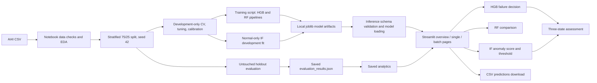

# System Architecture

## Component flow

## Data and model flow

1. **Dataset:** `ai4i+2020+predictive+maintenance+dataset/ai4i2020.csv` is read from a project-root-relative path. The local file has 10,000 rows, 14 columns, and 339 positive target rows.
2. **Notebook preparation:** the notebook validates columns, removes exact duplicates and required-field missing rows, selects the five fixed sensor columns, and uses `Machine failure` as target. IDs and failure-mode labels are excluded.
3. **Split:** `train_test_split(test_size=0.25, random_state=42, stratify=y)` creates a 7,500-row development partition and a 2,500-row final holdout. The training script repeats the same deterministic split from the same CSV and cleaning logic.
4. **Development experiments:** Phase 2 CV, randomized search, and threshold calibration use training-only partitions. SMOTE is within imbalanced-learn pipelines for fold isolation. The IF scaler and detector are fitted only on normal rows in an IF development sub-split; its threshold is chosen on a separate training-only calibration slice.
5. **Final evaluation:** holdout labels are used for saved final metrics and descriptive evaluation only. They are not used to fit the artifacts, tune model parameters, or choose the application thresholds.
6. **Artifacts:** `scripts/train_artifacts.py` writes HGB, Random Forest, and Isolation Forest joblib files plus metadata with feature order, thresholds, data hash, seed, fit scope, and versions. The app expects trusted local artifacts.
7. **Inference:** `app/inference.py` checks required and duplicate columns, numeric finite values, physically basic positive/nonnegative constraints, and feature order. Valid rows are ordered to the fixed five-feature schema; invalid batch rows are retained with an error and no prediction.
8. **Condition decision:** HGB prediction has precedence. If HGB predicts failure, the state is FAILURE RISK. Otherwise IF crossing score cutoff 0.571183 yields ANOMALOUS CONDITION; else NORMAL CONDITION.
9. **Presentation:** Streamlit pages show historical/saved metrics, single-input assessment, batch results and downloadable CSV. The analytics page reads saved evaluation JSON and does not recompute holdout scores from user input.

## Key files

| Path | Responsibility |
|---|---|
| `Machine_Fault_Intelligence_Improved.ipynb` | Phases 1–3 EDA, experiments, final evaluation, anomaly analysis, and condition logic |
| `scripts/train_artifacts.py` | Deterministic local artifact training from the fixed development split |
| `models/*.joblib` | Trained HGB, Random Forest, and Isolation Forest pipelines |
| `models/metadata.json` | Feature schema, thresholds, training provenance, and package versions |
| `models/evaluation_results.json` | Saved notebook evaluation values used by dashboard analytics |
| `app/inference.py` | Artifact loading, input validation, prediction, and condition state logic |
| `app/main.py` | Streamlit navigation, shared data/model loading, theme |
| `app/pages/` | Overview, single prediction, batch and analytics screens |
| `tests/` | Inference, batch, condition, artifact-loading, and app-startup tests |

## Runtime boundary

All inference is local to the Streamlit process. There is no sensor connection, message broker, external API, persistence service, authentication layer, or monitoring loop. Joblib loading assumes the model files are trusted project artifacts. Model scores and condition states are decision-support outputs for a synthetic-data demonstration, not production instructions.
